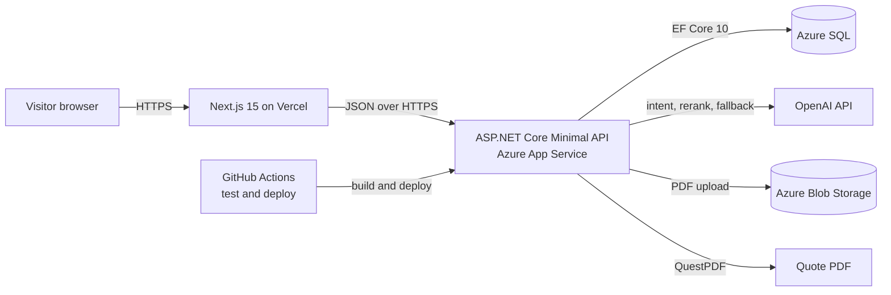

# AutoPreventivo

**Free-text Italian renovation requests in. Itemised quotes out.**

> **Documentation-only case study.** This repository describes a private production system; it is
> not a runnable app and has no build step. The live product is at
> [edilvos.it](https://www.edilvos.it). Screenshots are waived in this version; the placeholder
> blocks are commented out and recorded in [screenshots/MANIFEST.md](screenshots/MANIFEST.md).
>
> Snapshot: private backend `bd8bf3c`, 2026-11-26; private frontend `bc9a48e`, 2026-02-28.
> See [SYNC.md](SYNC.md).

## At a glance

| | |
|---|---|
| **Role** | Sole developer — design, backend, pricing, PDF, frontend, deployment |
| **Scale** | 6 renovation recipes · 16 API endpoints + `/health` · 2 quote paths · 121 price-list rows · 5–30 quotes/month |
| **Stack** | .NET 10 · ASP.NET Core Minimal APIs · EF Core 10 · Azure SQL · Azure App Service · Next.js 15 |
| **Status** | Private production system; this repository is a sanitized case study; 48 in-process tests gate deployment |
| **Live** | [edilvos.it](https://www.edilvos.it) |

## The problem

A construction cooperative quoted renovations by hand: a site visit, a price-list lookup for
every material and task, and an estimate typed into a document. The catalogue is large, the
Italian request arrives as free text, and the same job can be quoted differently by different
people.

AutoPreventivo turns a homeowner's description into an itemised quote. The hard part is not
generating text. It is producing a number that a business can send to a customer.

<!-- SCREENSHOT: quote-form | Desktop quote form filled with synthetic data | redact name, phone, email, address -->
<!-- Waived 2026-11-18. Uncomment when the sanitized image is supplied.
> 🖼️ **SCREENSHOT NEEDED — quote form.** Synthetic data only. Redact name, phone, email, address.
> Expected file: `screenshots/quote-form.png`.
-->

## What I built

- The .NET backend: 8-project solution, Minimal APIs, MediatR handlers, EF Core, 16 API endpoints.
- The pricing pipeline: six renovation recipes, catalogue resolution, guards, decimal totals.
- PDF generation with QuestPDF and storage in Azure Blob Storage.
- The Next.js frontend: marketing site, quote form, admin dashboard and the CreaTivo builder.
- The deployment: GitHub Actions to Azure App Service, with tests gating deployment.
- The hardening: request validation, centralised admin-key access control, structured logging,
  Application Insights telemetry, correlation IDs and `/health`.

## The boundary that matters

> **The model translates. The code prices.** Catalogue items are priced deterministically from the
> price list. A line with no catalogue match gets a labelled model estimate. No model returns the
> total.

The model parses Italian free text into a structured intent: recipe, dimensions, scope flags,
materials, counts. Deterministic recipes turn that intent into quantities and catalogue
references. C# computes every line total and the quote total in `decimal`.

When no catalogue entry survives the guards, the line receives a model-estimated unit price and is
tagged `AI_ESTIMATE`; the UI and PDF show it. That fallback is visible and bounded, not silent.

Full reasoning: [docs/pricing-boundary.md](docs/pricing-boundary.md). Diagram:
[pricing-pipeline.mmd](diagrams/pricing-pipeline.mmd).

## Request flow

1. The visitor submits a description at `edilvos.it` with a reCAPTCHA token.
2. `POST /api/quotes/generate` verifies the token before doing anything else.
3. The model returns structured intent under a JSON schema; invariants are repaired.
4. A deterministic recipe builds line items, quantities and waste factors.
5. Known catalogue codes resolve directly; unknown items go through candidate search, a model
   rerank and sanity guards.
6. C# calculates the totals.
7. QuestPDF renders the PDF; it is stored in Blob Storage and referenced from SQL.

Full detail: [docs/request-flow.md](docs/request-flow.md). Diagram:
[request-flow.mmd](diagrams/request-flow.mmd).

## Two quote paths

| | **AutoPreventivo** | **CreaTivo** |
|---|---|---|
| Input | Free-text Italian from the client | Operator-entered lines in the admin panel |
| AI | Parses intent | None |
| Pricing | Deterministic recipes and catalogue lookups | Operator-entered unit prices |
| Draft mode | Not applicable | Yes — skips PDF until published |
| PDF and storage | QuestPDF → Blob → SQL | Same services, same Blob, same repository |

CreaTivo reuses the existing quote entity, PDF generator, blob upload, repository and admin list.
Only the creation path is new. Detail: [docs/creativo.md](docs/creativo.md).

<!-- SCREENSHOT: quote-result | Generated quote items and total with synthetic data | fake customer, round amounts -->
<!-- Waived 2026-11-18. Uncomment when the sanitized image is supplied.
> 🖼️ **SCREENSHOT NEEDED — quote result.** Synthetic data only. Fake customer, round amounts.
> Expected file: `screenshots/quote-result.png`.
-->

## Architecture

`Edilvos.*` is a small shared shell; `AutoPreventivo.*` is the product. The API is ASP.NET Core
Minimal APIs on .NET 10, with EF Core 10 over SQL Server locally and Azure SQL in production.
QuestPDF renders documents; Azure Blob Storage holds them. The model provider is the OpenAI API.

- Persistence: EF Core 10, 18 migrations, three tables.
- Catalogue: 121 price-list rows imported from three CSVs.
- Deployment: GitHub Actions, Azure App Service, no container image.
- Qdrant was a local prototype for semantic search and is not deployed.

Detail: [docs/architecture.md](docs/architecture.md). Diagram:
[system-context.mmd](diagrams/system-context.mmd).

## Production hardening

| Area | State at this snapshot |
|---|---|
| Runtime | .NET 10 / EF Core 10, deployed from `bd8bf3c` |
| Request validation | `POST /api/quotes/manual` returns `400 ValidationProblemDetails` with field errors; `PUT /api/quotes/{id}` remains unvalidated |
| Admin access | One endpoint filter guards all 11 admin routes; a missing or empty configured key fails closed; key comparison uses SHA-256 and `CryptographicOperations.FixedTimeEquals` |
| Observability | Serilog structured logs, Application Insights requests and traces, correlation IDs, `/health` |
| Transport | HTTPS Only enabled on App Service |
| Tests and CI | 48 xUnit/Moq tests; the test job runs on pull requests and gates deployment on `main` |
| Identity | Still a shared `X-Admin-Key` secret, not user identity |

Not implemented and not claimed: Entra ID, Managed Identity, Key Vault, user authentication,
per-user audit, key rotation, alerts or dashboards.

## Changes after the original snapshot

The case study first described backend `2dee6ae` on 2026-05-30. It now describes `bd8bf3c` on
2026-11-26:

- **Phase 3:** the xUnit suite was merged, a CI test stage was added, and `sync-qdrant` gained its
  missing admin-key check. 21 tests at that point.
- **Phase 4:** manual-quote request validation, a centralised fail-closed admin-key filter,
  Serilog, Application Insights, correlation IDs and `/health`; HTTPS Only enabled.
- **Phase 5:** .NET 10 / EF Core 10 upgrade, 48 tests, deployed and smoke-tested in production.

## Frontend surfaces

- **Public:** marketing site, services, gallery, quote form, quote result and PDF download.
- **Admin:** quote dashboard, CreaTivo builder, price-list management, settings; behind the admin
  key.
- **Stack:** Next.js 15, React 19, TypeScript, Tailwind, Sanity, Vercel.
- **Instrumentation:** GA4, Microsoft Clarity, Vercel Analytics, behind a consent banner.

Reviewed excerpts: [manual quote server action](snippets/05-create-manual-quote-action.ts) and
[provenance tags](snippets/06-provenance-tags.tsx). Detail:
[docs/frontend.md](docs/frontend.md).

## API

Six representative endpoints; the rest are omitted deliberately. All examples are synthetic.

Endpoint table

| Method | Path | Purpose | Auth |
|---|---|---|---|
| POST | `/api/quotes/generate` | Create a quote from free text or structured input | reCAPTCHA |
| GET | `/api/quotes/{id}` | Retrieve a quote | None |
| GET | `/api/quotes/{id}/pdf` | Download the PDF | None |
| POST | `/api/quotes/manual` | Create a manual quote | `X-Admin-Key` |
| PUT | `/api/quotes/{id}` | Update a manual quote | `X-Admin-Key` |
| GET | `/api/pricelist` | Read the catalogue | `X-Admin-Key` |

`GET /health` is public and liveness-only; it checks no external dependency.

Full contract with synthetic request and response bodies:
[docs/api-contract.md](docs/api-contract.md).

<!-- SCREENSHOT: pdf-output | First page of a generated PDF with synthetic data | fake customer, no real prices -->
<!-- Waived 2026-11-18. Uncomment when the sanitized image is supplied.
> 🖼️ **SCREENSHOT NEEDED — PDF output.** Synthetic data only. No real customer or prices.
> Expected file: `screenshots/pdf-output.png`.
-->

## Data and pricing

A quote has a header and ordered line items. Each line carries a code, category, description,
unit, quantity and unit price. Quantities, line prices and catalogue prices are `decimal(18,2)`.
Totals are computed in C#, never stored.

The catalogue holds 121 imported rows. No real catalogue rows, supplier data or customer records
appear in this repository; examples are synthetic.

Detail: [docs/data-model.md](docs/data-model.md).

## Testing

- xUnit with Moq. 48 tests on `main`.
- Coverage includes exact totals for five renovation recipes, the `AI_ESTIMATE` fallback,
  missing price-list codes, unknown recipes, intent-invariant repair, malformed model JSON,
  Italian decimal commas, the admin-key guard, validation 400s with no repository write, every
  admin route returning 401 without a key, `/health`, and correlation-ID behaviour.
- The GitHub Actions test job runs on pull requests and before deployment on `main`. Deploy
  depends on it.
- Honest scope: the tests are in-process, using mocks and a `WebApplicationFactory` TestServer.
  They do not use a real SQL Server, Azure SQL, Blob Storage, Qdrant or OpenAI endpoint.
- One test asserts an exact total to the cent and proves the semantic path is not called when
  every line has a catalogue code.

Detail: [docs/testing.md](docs/testing.md). Snippet:
[04-exact-total-test.cs](snippets/04-exact-total-test.cs).

## Evaluation

Thesis evaluation across **42 estimates**:

- Kitchen total-cost deviation: **39% → 0%**.
- **€1,822.83** of erroneous cost removed.
- Floor-screed hallucination: **271% → 0%** over the same iterations.
- Full apartment total: **−4.3%** (€101,978.33 → €97,574.64).

Limitation: the same 42 estimates were used for tuning; there is no holdout set. This is not a
generalised accuracy claim. Detail: [docs/evaluation.md](docs/evaluation.md).

<!-- SCREENSHOT: admin-dashboard | Admin quote list or detail view | blur names, emails, phones, addresses -->
<!-- Waived 2026-11-18. Uncomment when the sanitized image is supplied.
> 🖼️ **SCREENSHOT NEEDED — admin view.** Blur all names, emails, phones, addresses.
> Expected file: `screenshots/admin-dashboard.png`.
-->

## Limitations

- Solo developer; no code-review process.
- Admin auth is a shared secret, not enterprise identity. It is now centralised, fail-closed and
  constant-time, but there is still no per-user identity, audit trail, rotation or expiry.
- The admin key lives in browser storage.
- Observability collects data, but there are no alert rules or dashboards yet.
- Validation covers manual quote creation; `PUT /api/quotes/{id}` remains unvalidated.
- Application Insights request and trace telemetry is live; dependency and exception telemetry
  was not exercised by the production smoke traffic, and there are no alerts or dashboards.
- Deployment authenticates with a credential secret, not OIDC.
- No infrastructure as code.
- No rate limiting beyond reCAPTCHA on quote creation.
- No automatic quote-notification email.
- Tests are in CI but in-process only: no real database, blob, Qdrant, OpenAI, PDF-layout or
  browser tests. No load testing.
- App Service runs on the F1 Free plan with no deployment slot; risky runtime changes can hit
  worker-stop quota and disable the site.
- Qdrant semantic lookup is local-only.
- Evaluation has no holdout set.
- No pricing provenance is persisted beyond the `AI_ESTIMATE` tag.
- No multi-tenant model, versioned price lists or role separation.

Detail: [docs/limitations.md](docs/limitations.md).

## What I would do next

- Real admin identity and key rotation, then Managed Identity and Key Vault.
- Integration tests against SQL Server, Azure SQL, Blob Storage and Qdrant in an isolated
  environment.
- Alert rules and dashboards for 5xx rate, dependency failures and exceptions.
- Persist pricing provenance per line item.
- Add a validator for quote updates.
- Move the model provider to Azure OpenAI.
- Remove the `WithOpenApi` deprecation warnings and address the `Resend` /
  `Microsoft.AspNetCore.WebUtilities` advisory.
- Move off the F1 Free plan or add a deployment slot before risky changes.

## Links

- Live product: [edilvos.it](https://www.edilvos.it)
- Code excerpts: [snippets/](snippets/README.md)
- Portfolio: [marco.gl](https://www.marco.gl)
- CV and contact: available on request.

---

## Screenshot manifest

Every hidden `<!-- SCREENSHOT: ... -->` marker above has a row in
[screenshots/MANIFEST.md](screenshots/MANIFEST.md), currently `WAIVED`. No image link is added
until the file exists.
